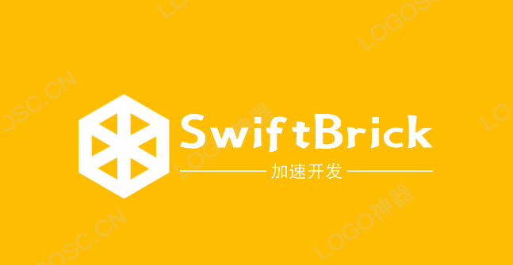

[](http://cocoapods.org/pods/SwiftBrick)
[](https://swift.org/package-manager/)


此Package与[Gitee](https://gitee.com/zjinhu/swift-brick)同步，如果觉得SPM引入github地址偏慢可以使用Gitee。

SwiftBrick是一个简单易用、功能丰富的UI基础框架，主要目的是为了快速搭建APP UI。包含颜色资源（全部支持暗黑模式）、基础视图控制器、可复用单元格、UIKit扩展和实用工具类。

## 功能

### BaseVC 基础视图控制器

- 包括常见的ViewController基类：`TableViewController`、`CollectionViewController`、`WebViewController`、`ViewController`、`SwiftUIVC`
- 导航栏左右按钮处理，支持闭包回调
- VC间导航栏显示/隐藏平滑过渡

### BaseCell 基础单元格

- TableView、CollectionView 的 Cell 基类
- Header/Footer 注册，方便复用
- `Reusable` 协议消除样板代码

### Extensions 扩展

| 扩展 | 功能 |
|------|------|
| `UINavigationBar` | 背景色修改、分割线隐藏、透明度变化 |
| `UINavigationController` | 出入栈导航栏隐藏/展示平滑切换 |
| `UIViewController` | 状态栏显示/隐藏、导航栏按钮辅助方法 |
| `UIView` | 渐变色背景、点击手势闭包、查找父VC |
| `UITableViewCell` | 各种样式分割线（完整、中间、底部） |
| `UIButton` | 图文排版、闭包点击事件、IBInspectable状态属性 |
| `UIGestureRecognizer` | 闭包手势 |
| `UIStackView` | 便捷初始化、背景视图、批量添加/移除 |
| `UITabBar` | 角标管理、全局外观设置 |
| `UITextView` | 占位符支持 |
| `UIColor` | RGB/十六进制/随机颜色、明暗动态色、渐变生成 |
| `UIImage` | SF符号辅助、颜色提取、SHA256 |
| `UIImageView` | 占位图缓存 |
| `CALayer` | 阴影、边框、圆角（部分圆角） |
| `Array` | 安全索引、元素查找、删除、JSON转换 |
| `Dictionary` | 键检查、所有键值、JSON转换 |
| `String` | SHA256、JSON解析、本地化 |
| `Data` | SHA256哈希 |
| `Dispatch` | 多优先级线程、延迟执行 |
| `UserDefaults` | Codable支持、下标访问 |
| `Layout` | Auto Layout约束构建器、安全区域锚点、自适应缩放 |

### Util 工具类

| 工具 | 功能 |
|------|------|
| `Define` | 屏幕尺寸、导航栏/标签栏高度、1像素线宽 |
| `Device` | 设备检测（iPhone X、iPad）、iOS版本检查 |
| `Version` | iOS版本比较（`Version() > Version(15, 0, 0)`） |
| `Font` | 系统字体、苹方字体多字重、自适应字号 |
| `TapBuzz` | 震动反馈（冲击、选择、通知） |
| `BrickLog` | 结构化日志多级别（iOS 14+） |
| `AppState` | 检测调试/TestFlight/AppStore环境 |
| `Application` | 应用名称、版本号、构建号、Bundle ID |
| `UIAdapter` | 全UI类型屏幕适配缩放 |
| `Locale` | 当前系统语言代码 |
| `Loader` | Bundle资源加载（颜色、图片） |

### ViewFactory 自定义视图

- `InsetLabel`: 支持内边距的 UILabel
- `UILineView`: 绘制实线/虚线（横向/竖向）

## 安装

### Cocoapods

1. 在 Podfile 中添加 `pod 'SwiftBrick'`
2. 执行 `pod install` 或 `pod update`
3. 导入 `import SwiftBrick`

### Swift Package Manager

从 Xcode 11 开始，集成了 Swift Package Manager，使用起来非常方便。SwiftBrick 也支持通过 Swift Package Manager 集成。

在 Xcode 的菜单栏中选择 `File > Swift Packages > Add Package Dependency`，然后在搜索栏输入

`https://github.com/jackiehu/SwiftBrick`，即可完成集成

### 手动集成

SwiftBrick 也支持手动集成，只需把 Sources 文件夹中的 SwiftBrick 文件夹拖进需要集成的项目即可

## 快速使用

```swift
import SwiftBrick

// 获取屏幕尺寸
let width = Define.screenWidth
let height = Define.screenHeight
let fitW = Define.fitWidth    // 例如 30 * fitW 自适应宽度

// 设备检测
if Device.isiPhoneX { /* 有刘海 */ }
if Device.isiPad { /* 是iPad */ }

// 震动反馈
TapBuzz.light()
TapBuzz.success()

// 颜色辅助
let color = UIColor(r: 255, g: 128, b: 0)
let hexColor = UIColor(hex: 0xFF8000)
let hexStrColor = UIColor("#FF8000")

// 渐变背景
view.ss.setBackColor([.red, .blue])

// Auto Layout 约束
view.ss.makeConstraints { maker in
    maker.topAnchor(equalTo: view.ss.safeTopAnchor).offset(20)
    maker.leadingAnchor(equalTo: view.ss.safeLeadingAnchor).offset(16)
    maker.trailingAnchor(equalTo: view.ss.safeTrailingAnchor).offset(-16)
    maker.heightAnchor(44)
}

// 按钮闭包点击
button.addTouchUpInSideBtnAction { sender in
    print("点击了按钮")
}

// 导航栏全局设置
UINavigationBar.setBackgroundColor(.white)
UINavigationBar.setTitleColor(.black)
UINavigationBar.setShadowColor(.clear)

// UserDefaults 属性包裹器
@UserDefault("username", defaultValue: "游客")
static var username: String?
```

## AI Skills 集成

SwiftBrick 包含一份专为 AI 助手设计的 **SKILLS.md** 文件，提供：

- 完整的双语 API 参考文档
- 每个功能的使用模式和代码示例
- 架构概览
- 常见实现模式

### 如何在 AI 中使用 SKILLS.md

在使用 AI 编程助手（如 Cursor、GitHub Copilot、Claude 等）时，引用 SKILLS.md 文件可以获得准确的 SwiftBrick 代码建议：

**1. 将文件添加到 AI 工具上下文**

将 `SKILLS.md` 添加到你的 AI 工具上下文中，或在提示词中引用：

```
参考文件：@SKILLS.md
```

**2. 请求特定功能**

```
使用 SwiftBrick 创建一个带有自定义单元格和渐变背景的 TableViewController。
请参考 SKILLS.md 中的 API 文档。
```

**3. 获取正确的约束语法**

```
如何用 SwiftBrick 添加 Auto Layout 约束？查看 SKILLS.md 的 Layout 部分。
```

**4. 验证 API 用法**

```
在 SwiftBrick 中注册和复用单元格的正确方式是什么？
参考 SKILLS.md 的 Base Cells 部分。
```

### AI 提示词示例

```
@SKILLS.md 

创建一个 HomeVC，要求：
1. 继承 TableViewController，使用分组样式
2. 带有蓝紫色渐变背景
3. 注册自定义单元格
4. 添加右侧导航栏按钮，使用 SF Symbol 图标
5. 单元格选中时显示触觉反馈
```

### SKILLS.md 内容结构

```
SKILLS.md
├── Overview / 概述
├── Quick Start / 快速开始
│   └── Global Shortcuts / 全局快捷访问
├── The .ss Accessor Pattern / .ss 访问器模式
├── Base View Controllers / 基础视图控制器
│   ├── ViewController
│   ├── TableViewController
│   ├── CollectionViewController
│   ├── WebViewController
│   └── SwiftUIVC
├── Base Cells / 基础单元格
│   ├── TableViewCell
│   ├── CollectionViewCell
│   └── Header/Footer Views
├── Layout Extensions / 布局扩展
│   ├── Constraints Maker
│   ├── Safe Area Anchors
│   └── Adaptive Scaling
├── UI Extensions / UI扩展
│   └── (所有UIKit扩展的使用示例)
├── Utilities / 工具类
│   └── (所有工具类的使用示例)
├── Common Patterns / 常用模式
└── Architecture / 架构
```

## 更多砖块工具加速APP开发

[](https://github.com/zjinhu/SwiftMediator)

[](https://github.com/zjinhu/SwiftLog)

[](https://github.com/zjinhu/SwiftMesh)

[](https://github.com/zjinhu/SwiftNotification)
